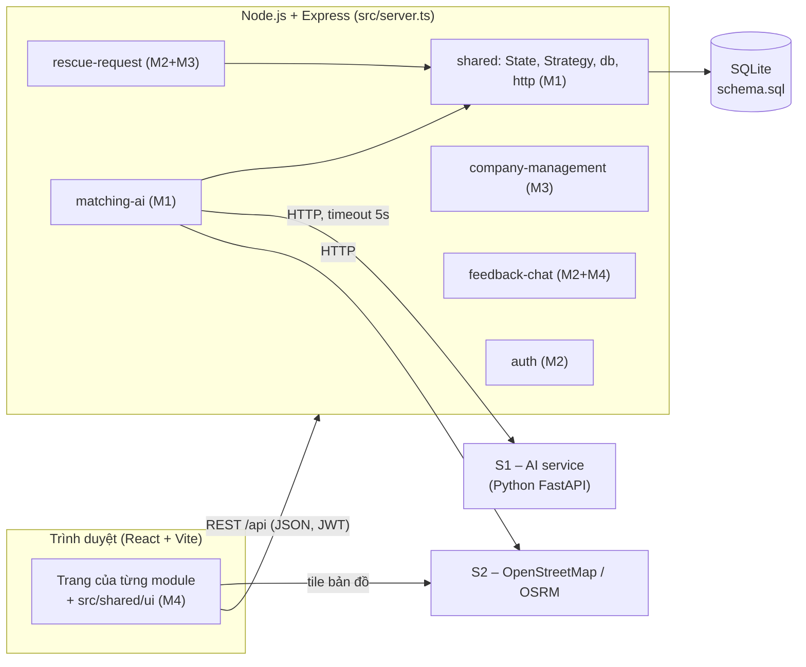
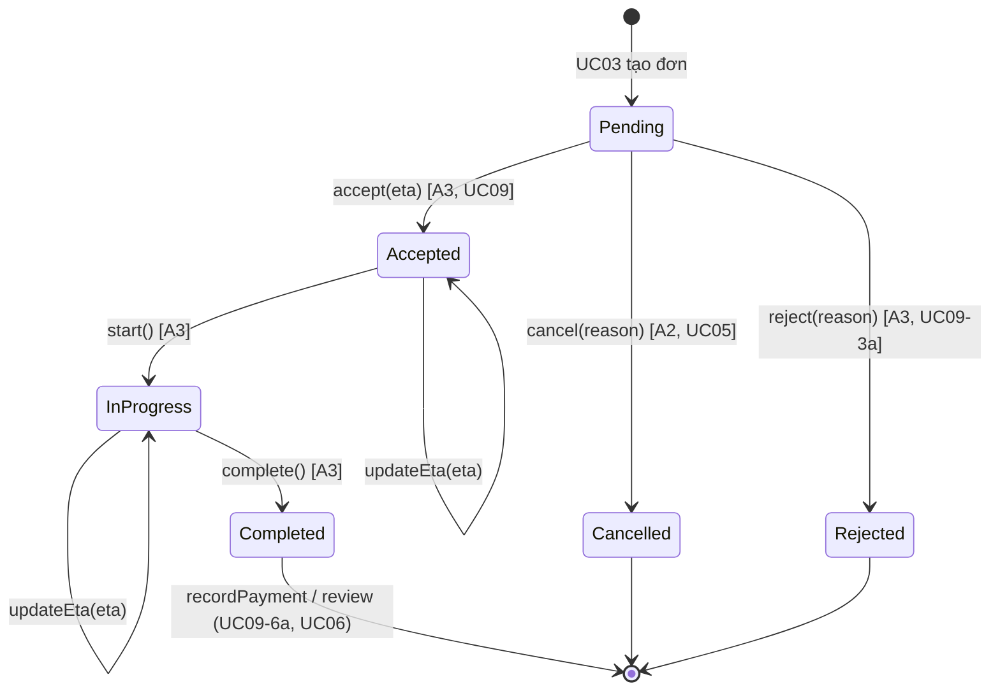
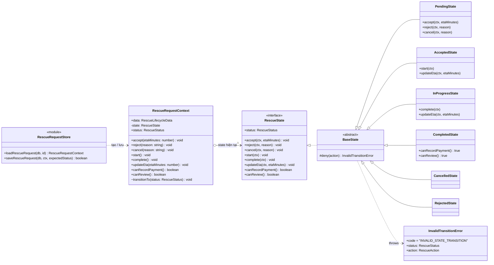
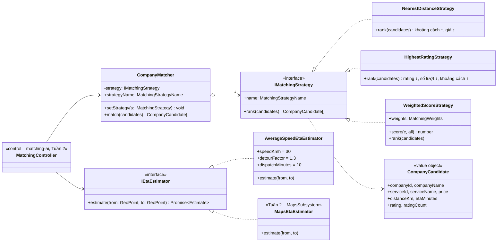
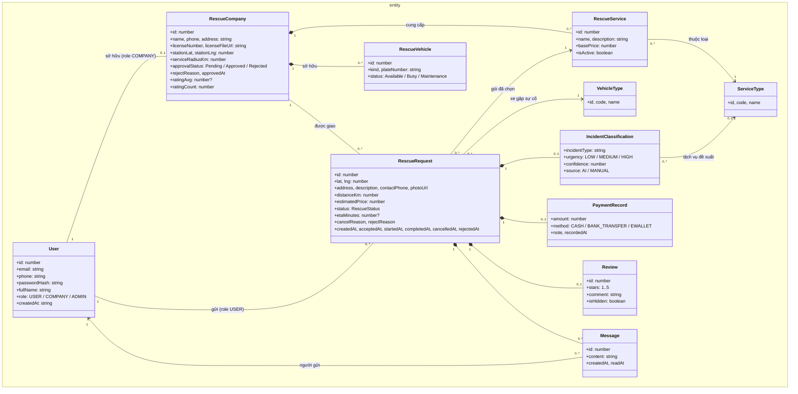

# M1 – Tuần 1: Tech Stack, Design Patterns cốt lõi & Gói Entity

Hệ thống hỗ trợ sự cố xe trên đường · Người phụ trách: M1 · Dùng cho báo cáo mục **3.1, 3.4.1–3.4.3, 4.1**.

Sơ đồ viết bằng Mermaid: GitHub/VS Code hiển thị trực tiếp; để chèn vào báo cáo, dán khối code vào <https://mermaid.live> rồi xuất PNG/SVG.

---

## 1. Tech Stack đã chốt (báo cáo 4.1)

| Tầng | Công nghệ | Lý do chọn |
|---|---|---|
| Ngôn ngữ | **TypeScript** cho cả Frontend và Backend | Một ngôn ngữ cho 4 người làm full-stack theo lát cắt dọc; kiểu dữ liệu chung giữa API và UI |
| Runtime | **Node.js ≥ 22.18** (chạy `.ts` trực tiếp, không cần build backend) | Không phải cấu hình ts-node/babel |
| Backend | **Express 5** – REST JSON theo `docs/contracts/api-contract.md` | Đơn giản, quen thuộc, tự bắt lỗi async |
| CSDL | **SQLite** qua `node:sqlite` có sẵn trong Node; schema ở `docs/contracts/schema.sql` | Không cần cài DB server/Docker; file `data/app.db` tự tạo khi chạy |
| Frontend | **React + Vite + React Router**, **Tailwind CSS v4** đọc `design-tokens.css` | Mobile-first cho A2, desktop cho A3/A4; token màu/chữ thành utility (`bg-primary`) |
| Bản đồ (S2) | **Leaflet + react-leaflet** với bản đồ nền **OpenStreetMap** | Miễn phí, không cần API key; Tuần 2 thêm OSRM/Haversine cho khoảng cách & ETA |
| Xác thực | **JWT** (`jsonwebtoken`) + băm mật khẩu **bcryptjs** | Stateless, đủ cho 3 vai trò |
| Upload | **multer** (ảnh hiện trường, giấy phép) lưu ở `data/uploads` | |
| AI (S1, Tuần 3) | **Python + scikit-learn** (TF-IDF + Logistic Regression/SVM), phục vụ qua **FastAPI** `POST /classify` | Đúng vai trò Actor ngoài S1: phân hệ tách riêng, backend gọi có timeout 5 giây → fallback chọn tay |
| Thời gian thực | Polling 5 giây/lần (`GET /rescue-requests/:id`) | Theo phạm vi đề bài, không cần WebSocket |
| Kiểm thử | `node --test` (có sẵn trong Node) | Không thêm thư viện test |
| Quản lý mã | Git, nhánh `main` (ổn định) ← `dev` (tích hợp) ← `feature/<module>-<tên>` | Họp tối Chủ Nhật kiểm tra tính năng chạy trên `dev` |

### Kiến trúc tổng thể & phân gói (báo cáo 3.1)

Client–Server 3 tầng; mỗi module chứa cả UI (`*.tsx`) lẫn API (`*.api.ts`) của mình (vertical slice), chỉ dùng chung `src/shared` và `docs/contracts`.



```
docs/design/                        tài liệu thiết kế từng thành viên (nằm ngoài code)
roadside-assistance/                toàn bộ mã nguồn (repo code)
  docs/contracts/   schema.sql · api-contract.md · design-tokens.css   ← chỉ M1 sửa, báo trước
  src/server.ts     khởi động API, mount router các module
  src/main.tsx      khởi động UI, khai báo route các module
  src/shared/       state/ (State Pattern) · strategy/ (Strategy Pattern) · db.ts · http.ts · ui/ (M4)
  src/auth/  src/rescue-request/  src/company-management/  src/matching-ai/  src/feedback-chat/
```

---

## 2. State Pattern – vòng đời `RescueRequest` (báo cáo 3.4.2)

Mã nguồn: [`src/shared/state/rescue-request-state.ts`](../../roadside-assistance/src/shared/state/rescue-request-state.ts), lưu DB: [`rescue-request-store.ts`](../../roadside-assistance/src/shared/state/rescue-request-store.ts).

**Vấn đề:** cùng một thao tác (hủy, nhận, hoàn tất…) hợp lệ hay không tùy trạng thái đơn. Viết `if (status === ...)` rải rác trong controller của M2 và M3 dễ sai lệch (ví dụ M2 cho hủy đơn đã Accepted).
**Giải pháp:** mỗi trạng thái là một lớp; controller chỉ gọi `ctx.cancel()`, `ctx.accept()`… Lớp trạng thái hiện tại tự quyết định chuyển sang trạng thái nào, hoặc ném `InvalidTransitionError` (HTTP 409).

### 2.1 Biểu đồ trạng thái



### 2.2 Biểu đồ lớp



### 2.3 Quyết định thiết kế
- `BaseState` mặc định **chặn mọi thao tác**; lớp con chỉ override thao tác được phép → thêm thao tác mới thì mặc định an toàn.
- 6 lớp State không giữ dữ liệu riêng nên dùng chung một instance mỗi lớp (Flyweight); dữ liệu nằm ở `RescueRequestContext.data`.
- **Xung đột đồng thời** (UC05-4.1: người dùng hủy đúng lúc công ty nhận; UC09-4.1 ngược lại): `saveRescueRequest` chỉ ghi khi `WHERE status = expectedStatus`. Bên ghi sau nhận `false` → controller trả 409, client tải lại đơn. Có test trong `rescue-request-state.test.ts`.
- Thanh toán và đánh giá không phải trạng thái mới mà là **quyền** của trạng thái Completed (`canRecordPayment`, `canReview`).

---

## 3. Strategy Pattern – ghép nối công ty & ETA (báo cáo 3.4.3)

Mã nguồn: [`src/shared/strategy/matching-strategy.ts`](../../roadside-assistance/src/shared/strategy/matching-strategy.ts), [`eta-estimator.ts`](../../roadside-assistance/src/shared/strategy/eta-estimator.ts).

**Vấn đề:** S03 cho người dùng sắp xếp "Gần nhất / Đánh giá cao nhất", và nhóm muốn thử thêm cách chấm điểm tổng hợp; ETA Tuần 1 tính đường chim bay, Tuần 2 chuyển sang Maps.
**Giải pháp:** hai họ thuật toán hoán đổi được qua interface: `IMatchingStrategy` (xếp hạng) và `IEtaEstimator` (khoảng cách + ETA). API chọn strategy theo query `strategy=nearest|rating|weighted`.



**Công thức:**
- ETA (Tuần 1) = `ceil(dispatchMinutes + distanceKm / speedKmh × 60)`, với `distanceKm = Haversine × detourFactor`. Tham số là giả định nội đô, sẽ thay bằng thời gian đường đi từ Maps ở Tuần 2.
- Weighted score = `0.5 × ETA_chuẩn_hóa + 0.3 × rating/5 + 0.2 × giá_chuẩn_hóa`; ETA và giá chuẩn hóa min–max trong chính danh sách ứng viên (thấp hơn → gần 1). Công ty chưa có đánh giá được rating = 0.

**Luồng dùng (Tuần 2, M1):** truy vấn công ty `Approved` có gói `isActive` đúng loại dịch vụ → `IEtaEstimator.estimate()` cho từng công ty → lọc theo bán kính → `CompanyMatcher.match()` → trả `CompanyCandidate[]`.

---

## 4. Gói lớp Entity (báo cáo 3.4.1)

Ánh xạ 1–1 với bảng trong `schema.sql` (tên lớp PascalCase ↔ bảng snake_case số nhiều).



**Ghi chú ánh xạ từ lớp phân tích (Chương 2):** giữ nguyên `RescueRequest`, `IncidentClassification`, `RescueCompany`, `RescueService`, `RescueVehicle`, `PaymentRecord`; thêm `User` (UC01/UC02), `Review` (UC06), `Message` (UC07), và hai danh mục seed `ServiceType`, `VehicleType` (validation "VehicleType ID hợp lệ trong DB"). Trạng thái của `RescueRequest` không sửa trực tiếp mà đi qua `RescueRequestContext` (mục 2).

---

## 5. Việc còn mở cho họp Chủ Nhật
1. Nhóm xác nhận stack ở mục 1 (đặc biệt SQLite thay vì PostgreSQL/MySQL – đổi sau chỉ cần sửa `schema.sql` + `db.ts`).
2. Chốt trọng số mặc định `WeightedScoreStrategy` (0.5 / 0.3 / 0.2) và tham số ETA (30 km/h, hệ số 1.3, 10 phút chuẩn bị).
3. Danh mục `service_types`, `vehicle_types` và 7 nhãn `incidentType` (api-contract §4) – M1 dùng làm nhãn dữ liệu AI Tuần 3.
4. Tạo remote GitHub, mời 3 thành viên, bật bảo vệ nhánh `main`.
