# M1 – Tuần 2: Matching Engine & MapsSubsystem

Hệ thống hỗ trợ sự cố xe trên đường · Người phụ trách: M1 · Dùng cho báo cáo mục **3.3.1** (MapsSubsystem), **3.4.3** (Strategy Pattern), **4.2.2** (logic ghép nối).
Hợp đồng: [api-contract.md §3.3](../contracts/api-contract.md) – không đổi định dạng `CompanyCandidate` so với Tuần 1.

Sơ đồ viết bằng Mermaid (dán vào <https://mermaid.live> để xuất PNG cho báo cáo).

---

## 1. Mã nguồn

| File | Lớp thiết kế | Nội dung |
|---|---|---|
| [`src/matching-ai/maps-subsystem.ts`](../../src/matching-ai/maps-subsystem.ts) | `IMapsSubsystem`, `OsrmMapsSubsystem`, `MapsEtaEstimator`, `getEtaEstimator()` | Phân hệ giao tiếp S2 (thay lớp phân tích `MapsBoundary`) |
| [`src/matching-ai/matching.api.ts`](../../src/matching-ai/matching.api.ts) | `MatchingController`, `findCandidates()` | `GET /matching/companies`; `POST /ai/classify` tạm trả 503 tới Tuần 3 |
| [`src/matching-ai/incident-types.ts`](../../src/matching-ai/incident-types.ts) | – | 7 nhãn sự cố, mức khẩn cấp, bảng §4 nhãn → dịch vụ đề xuất (dùng chung API + UI, Tuần 3 AI trả đúng nhãn này) |
| [`src/shared/strategy/eta-estimator.ts`](../../src/shared/strategy/eta-estimator.ts) | `IEtaEstimator`, `AverageSpeedEtaEstimator` | Thêm `estimateMany()` để gọi Maps 1 lần cho cả danh sách |
| [`src/shared/strategy/matching-strategy.ts`](../../src/shared/strategy/matching-strategy.ts) | `CompanyMatcher`, 3 strategy | Giữ nguyên từ Tuần 1 |
| [`src/matching-ai/matching.test.ts`](../../src/matching-ai/matching.test.ts) | Test | Công thức ETA + fallback, gọi OSRM đúng URL / timeout, lọc ứng viên, API + validation |

Cấu hình (biến môi trường):

| Biến | Mặc định | Ý nghĩa |
|---|---|---|
| `MAPS_PROVIDER` | (trống) = OSRM | `offline` → chỉ dùng đường chim bay (test, máy không có mạng) |
| `OSRM_URL` | `https://router.project-osrm.org` | Máy chủ OSRM; chạy thật nên tự host |

---

## 2. Thiết kế giao diện hệ thống ngoài – MapsSubsystem (báo cáo 3.3.1)

**Vấn đề:** lớp phân tích `MapsBoundary` gọi thẳng dịch vụ bản đồ. Nếu viết lời gọi HTTP trong controller thì đổi nhà cung cấp (OSRM → Google/Mapbox) hoặc dịch vụ bị lỗi sẽ kéo theo sửa controller của M1 và M2.
**Giải pháp:** đóng gói S2 thành một phân hệ có **interface** `IMapsSubsystem`. Nơi khác chỉ biết `IEtaEstimator` (Strategy Pattern Tuần 1) qua `getEtaEstimator()`. `MapsEtaEstimator` là cầu nối: lấy quãng đường/thời gian từ phân hệ, áp công thức ETA, và tự chuyển sang ước tính đường chim bay khi phân hệ lỗi.

### 2.1 Biểu đồ lớp

```mermaid
classDiagram
  direction LR
  class IMapsSubsystem {
    <<interface – subsystem S2>>
    +routeMany(origins: GeoPoint[], destination: GeoPoint) Promise~Route[]~ (null = không có đường)
  }
  class OsrmMapsSubsystem {
    +baseUrl: string
    +timeoutMs = 3000
    +routeMany(origins, destination)
  }
  class Route {
    <<value object>>
    +distanceKm: number
    +durationMinutes: number
  }
  class IEtaEstimator {
    <<interface>>
    +estimate(from, to) Promise~Estimate~
    +estimateMany(from[], to) Promise~Estimate[]~
  }
  class MapsEtaEstimator {
    +maps: IMapsSubsystem
    +fallback: IEtaEstimator
    +dispatchMinutes = 10
    +trafficFactor = 1.5
  }
  class AverageSpeedEtaEstimator {
    +speedKmh = 30
    +detourFactor = 1.3
    +dispatchMinutes = 10
  }
  class MatchingController {
    <<control>>
    +GET /matching/companies
    +findCandidates(db, incident, serviceTypeCode, radiusKm, eta)
  }
  class RescueRequestController {
    <<control – M2>>
    +POST /rescue-requests
  }
  class CompanyMatcher
  class OSRM {
    <<Actor S2 – HTTP Table API>>
  }
  IMapsSubsystem <|.. OsrmMapsSubsystem
  OsrmMapsSubsystem ..> OSRM : GET /table/v1/driving
  OsrmMapsSubsystem ..> Route
  IEtaEstimator <|.. MapsEtaEstimator
  IEtaEstimator <|.. AverageSpeedEtaEstimator
  MapsEtaEstimator o--> IMapsSubsystem
  MapsEtaEstimator o--> IEtaEstimator : fallback
  MatchingController --> IEtaEstimator : getEtaEstimator()
  MatchingController --> CompanyMatcher
  RescueRequestController --> IEtaEstimator : tính lại distanceKm
```



### 2.2 Đặc tả interface

| Thao tác | Vào | Ra | Lỗi / ngoại lệ |
|---|---|---|---|
| `IMapsSubsystem.routeMany(origins, destination)` | Danh sách trạm công ty, điểm sự cố (WGS84) | Mảng cùng thứ tự `origins`: `{ distanceKm, durationMinutes }` hoặc `null` nếu không có đường lái xe | Ném lỗi khi mạng lỗi, HTTP ≠ 200, `code ≠ "Ok"` hoặc quá `timeoutMs` (3 giây) |
| `IEtaEstimator.estimateMany(from, to)` | Như trên | `{ distanceKm (làm tròn 0,1), etaMinutes (làm tròn lên) }[]` | **Không ném lỗi do Maps**: Maps lỗi → fallback cả danh sách; `null` → fallback cho trạm đó |

Cài đặt OSRM: một request Table API cho cả danh sách, điểm sự cố là `destinations=0`, các trạm là `sources=1..n`:
`GET {OSRM_URL}/table/v1/driving/{lngSựCố},{latSựCố};{lng1},{lat1};…?sources=1;…;n&destinations=0&annotations=duration,distance`.

### 2.3 Công thức ETA

| Nguồn | Công thức | Ghi chú |
|---|---|---|
| Maps (mặc định) | `ETA = ceil(10 + thời_gian_lái_OSRM × 1.5)` phút; `distanceKm` = quãng đường thực | 10 phút chuẩn bị xuất xe; ×1.5 bù việc OSRM tính tốc độ đường thông thoáng (không có dữ liệu kẹt xe nội đô) |
| Dự phòng (Maps lỗi / không có đường) | `distanceKm = Haversine × 1.3`; `ETA = ceil(10 + distanceKm / 30 × 60)` | Giữ nguyên công thức Tuần 1 |

Ví dụ đo thật (Hoàn Kiếm → Cầu Giấy): OSRM 8,1 km / 12 phút → ETA = ceil(10 + 12 × 1.5) = 28 phút.

---

## 3. Thiết kế chi tiết ghép nối (báo cáo 3.4.3, 4.2.2)

**Lọc** (`findCandidates`, tầng truy vấn): công ty `Approved` → gói `is_active = 1` đúng `serviceTypeCode` → trạm nằm trong `min(serviceRadiusKm của công ty, radiusKm của truy vấn)`.
Bán kính so theo **đường chim bay** (vùng phục vụ là hình tròn quanh trạm, lọc trước để giảm số điểm gửi Maps); `distanceKm`/`etaMinutes` trả về là **quãng đường thực** từ MapsSubsystem. Một công ty có nhiều gói cùng loại → mỗi gói là một ứng viên.

**Xếp hạng** (`CompanyMatcher` + strategy theo query `strategy`):

| Strategy | Nhãn trên S03 | Thứ tự |
|---|---|---|
| `nearest` (mặc định) | Gần nhất | `distanceKm` ↑, hòa thì giá ↑ |
| `rating` | Đánh giá cao nhất | `rating` ↓ (chưa có đánh giá xếp cuối), `ratingCount` ↓, `distanceKm` ↑ |
| `weighted` | Cân bằng | `0.5 × ETA_chuẩn_hóa + 0.3 × rating/5 + 0.2 × giá_chuẩn_hóa` (min–max trong danh sách) |

### 3.1 Biểu đồ trình tự – `GET /matching/companies`

```mermaid
sequenceDiagram
  autonumber
  participant UI as RescueRequestForm (S03)
  participant C as MatchingController
  participant DB as SQLite
  participant E as MapsEtaEstimator
  participant M as OsrmMapsSubsystem
  participant S2 as OSRM (S2)

  UI->>C: GET /matching/companies?lat&lng&serviceTypeCode&radiusKm&strategy
  C->>C: validate (tọa độ VN, loại dịch vụ có trong danh mục, 0 < radiusKm ≤ 200, strategy hợp lệ)
  C->>DB: công ty Approved ⋈ gói isActive đúng loại
  C->>C: lọc Haversine ≤ min(serviceRadiusKm, radiusKm)
  C->>E: estimateMany(trạm[], điểm sự cố)
  E->>M: routeMany(trạm[], điểm sự cố)
  M->>S2: GET /table/v1/driving/… (timeout 3 s)
  alt S2 trả kết quả
    S2-->>M: durations, distances
    M-->>E: Route | null cho từng trạm
    E->>E: ETA = ceil(10 + phút × 1.5); null → AverageSpeed cho trạm đó
  else lỗi mạng / timeout
    M-->>E: throw
    E->>E: AverageSpeedEtaEstimator cho cả danh sách
  end
  E-->>C: { distanceKm, etaMinutes }[]
  C->>C: CompanyMatcher(strategy).match(candidates)
  C-->>UI: { radiusKm, strategy, items }
  Note over UI: items rỗng → gợi ý "Mở rộng lên radiusKm + 10 km" (UC03-5.2)
```

---

## 4. Kết quả kiểm thử

`npm test` – [`matching.test.ts`](../../src/matching-ai/matching.test.ts): công thức ETA và 2 nhánh fallback; URL Table API đúng thứ tự `lng,lat`, đọc `null`, quá timeout ném lỗi (dùng máy chủ OSRM giả cục bộ); lọc Approved / isActive / bán kính; xếp hạng theo `strategy`; lỗi 400 đúng `details.field`; chỉ `USER` gọi được.
Chạy thật với OSRM công khai: 2 công ty mẫu ở Hà Nội trả về sau ≈ 1 giây.

## 5. Việc còn mở
1. **Tuần 3 – AISubsystem:** thay route tạm `POST /ai/classify` (đang trả `503 AI_UNAVAILABLE` để UI chạy nhánh UC03-4.1) bằng lời gọi dịch vụ Python có timeout 5 giây, cùng mẫu interface + fallback như MapsSubsystem.
2. Tìm vị trí theo địa chỉ (geocoding) chưa làm; UC03-2.1 hiện dùng chạm chọn trên bản đồ + ô "Địa chỉ / mốc" dạng chữ.
3. Máy chủ OSRM demo không có SLA: buổi bảo vệ nên tự host OSRM (Docker, dữ liệu Việt Nam) hoặc chạy `MAPS_PROVIDER=offline`.
