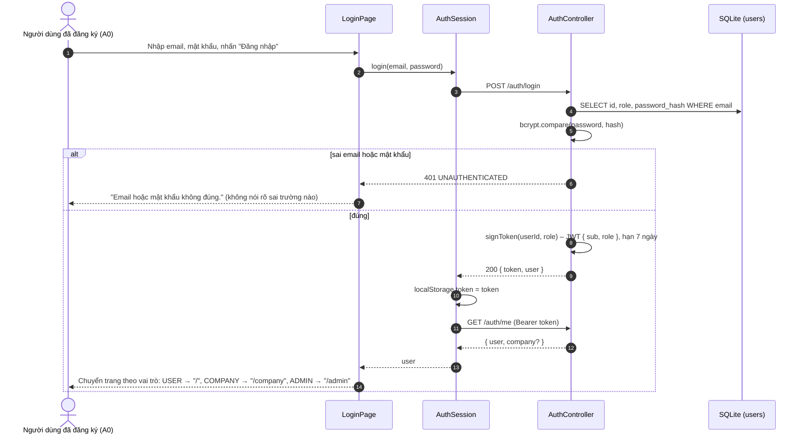
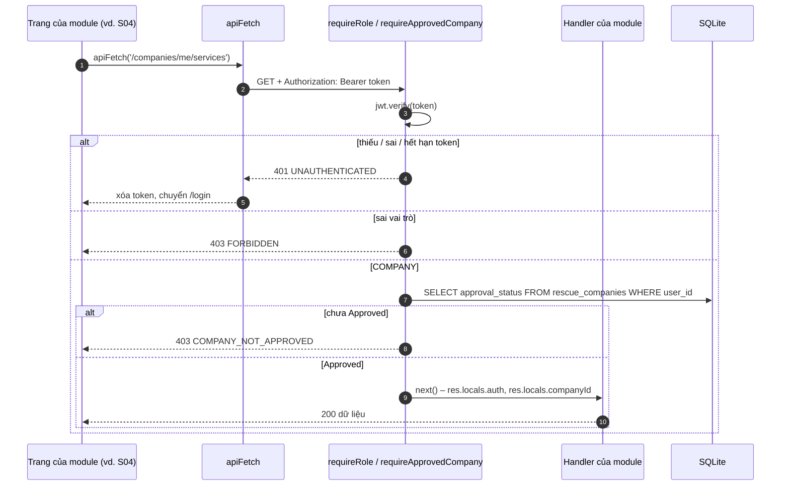
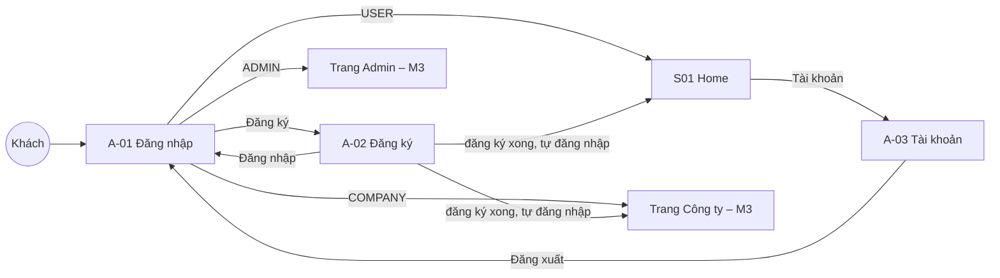
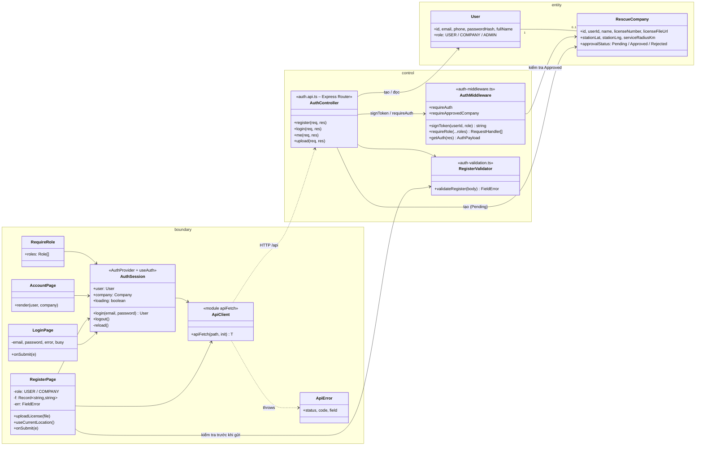

# M2 – Tuần 1: Module Xác thực & Hồ sơ người dùng

Hệ thống hỗ trợ sự cố xe trên đường · Người phụ trách: M2 · Use Case: **UC01 Đăng ký tài khoản**, **UC02 Đăng nhập**, Quản lý tài khoản (xem hồ sơ, đăng xuất).
Hợp đồng: [api-contract.md §1.2, §3.2](../contracts/api-contract.md) · Bảng `users`, `rescue_companies` trong [schema.sql](../contracts/schema.sql).

Sơ đồ viết bằng Mermaid (dán vào <https://mermaid.live> để xuất PNG cho báo cáo).

---

## 1. Mã nguồn

| File | Tầng | Nội dung |
|---|---|---|
| [`src/auth/auth.api.ts`](../../src/auth/auth.api.ts) | Control | `POST /auth/register`, `POST /auth/login`, `GET /auth/me`, `POST /uploads` (+ phục vụ file `/api/uploads/*`) |
| [`src/auth/auth-middleware.ts`](../../src/auth/auth-middleware.ts) | Control | `requireAuth`, `requireRole(...)`, `requireApprovedCompany`, `signToken`, `getAuth` – **module khác import để phân quyền** |
| [`src/auth/auth-validation.ts`](../../src/auth/auth-validation.ts) | Control (dùng chung FE/BE) | `validateRegister()` – một bộ quy tắc cho cả form và API |
| [`src/auth/session.tsx`](../../src/auth/session.tsx) | Boundary (client) | `AuthProvider`/`useAuth`, `apiFetch` (tự gắn token, chuẩn hóa lỗi), `<RequireRole>` chặn route theo vai trò |
| [`src/auth/LoginPage.tsx`](../../src/auth/LoginPage.tsx), [`RegisterPage.tsx`](../../src/auth/RegisterPage.tsx), [`AccountPage.tsx`](../../src/auth/AccountPage.tsx) | Boundary (UI) | Màn hình A-01, A-02, A-03 |
| [`src/auth/create-admin.ts`](../../src/auth/create-admin.ts) | Tiện ích | Tạo tài khoản ADMIN: `npm run create-admin -- <email> <matKhau>` (API không cho đăng ký ADMIN) |
| [`src/auth/auth.test.ts`](../../src/auth/auth.test.ts) | Test | Đăng ký/đăng nhập/me, lỗi 400/401/403/409, công ty chưa duyệt, upload |

---

## 2. Biểu đồ trình tự (Sequence Diagram)

### 2.1 UC01 – Đăng ký tài khoản (luồng Công ty cứu hộ; luồng Người gặp sự cố bỏ bước upload và bản ghi công ty)

```mermaid
sequenceDiagram
  autonumber
  actor A1 as Khách (A1)
  participant UI as RegisterPage
  participant V as validateRegister
  participant S as AuthSession (apiFetch)
  participant C as AuthController (auth.api)
  participant DB as SQLite (users, rescue_companies)

  A1->>UI: Chọn tab "Công ty cứu hộ", nhập thông tin
  A1->>UI: Chọn file giấy phép
  UI->>S: POST /uploads (multipart)
  S->>C: upload
  alt sai loại file / > 5 MB
    C-->>UI: 400 VALIDATION_ERROR (field = file)
    UI-->>A1: Báo lỗi dưới ô giấy phép
  else hợp lệ
    C-->>UI: 201 { url }
  end
  A1->>UI: Nhấn "Gửi hồ sơ đăng ký"
  UI->>V: validateRegister(form)
  alt dữ liệu sai (ngoại lệ 1)
    V-->>UI: { field, message }
    UI-->>A1: Báo lỗi dưới đúng ô, focus ô lỗi, giữ dữ liệu
  else hợp lệ
    UI->>S: POST /auth/register
    S->>C: register(body)
    C->>V: validateRegister(body) (kiểm tra lại phía server)
    C->>DB: SELECT users WHERE email
    alt email đã tồn tại (ngoại lệ 2)
      C-->>UI: 409 CONFLICT (field = email)
      UI-->>A1: "Email đã được sử dụng."
    else
      C->>C: bcrypt.hash(password)
      C->>DB: BEGIN; INSERT users(role=COMPANY); INSERT rescue_companies(approval_status=Pending); COMMIT
      C-->>UI: 201 { user }
      UI->>S: login(email, password) (xem 2.2)
      UI-->>A1: Chuyển trang chính Công ty – hồ sơ "Chờ duyệt"
    end
  end
```

### 2.2 UC02 – Đăng nhập



### 2.3 Phân quyền khi gọi API của module khác



---

## 3. Đặc tả giao diện (UI Spec)

Theo [UI Guidelines (M4)](../../../M4/01_UI_Guidelines_M4.docx) và [design-tokens.css](../contracts/design-tokens.css): mobile-first 390 px, 1 cột, padding 16 px, ô nhập/nút cao 48 px, label luôn hiện, lỗi đỏ ngay dưới ô, không mất dữ liệu đã nhập.

### Sơ đồ chuyển màn hình


Route cần đăng nhập mà chưa có token → A-01; đăng nhập xong quay lại trang định vào. Vào route của vai trò khác → về trang chính của vai trò mình.

### A-01 Đăng nhập (`/login`)
| Control | Loại | Kiểm tra / Sự kiện |
|---|---|---|
| Email | input email | bắt buộc |
| Mật khẩu | input password | bắt buộc |
| Đăng nhập | nút Primary | disabled khi thiếu trường hoặc đang gửi ("Đang đăng nhập…"); lỗi 401 → banner đỏ trên form |
| Đăng ký | link | → A-02 |

### A-02 Đăng ký (`/register`)
| Control | Loại | Kiểm tra (FE = BE, `validateRegister`) | Thông báo lỗi |
|---|---|---|---|
| Loại tài khoản | tab 2 lựa chọn | `USER` / `COMPANY` (không có ADMIN) | – |
| Họ tên | input | bắt buộc | "Vui lòng nhập họ tên." |
| Số điện thoại | input tel | `^0\d{9}$` | "Số điện thoại không hợp lệ." |
| Email | input email | đúng định dạng, chưa tồn tại (BE → 409) | "Email không hợp lệ." / "Email đã được sử dụng." |
| Mật khẩu / Nhập lại | input password | ≥ 8 ký tự; hai ô khớp (chỉ FE) | "Mật khẩu phải có ít nhất 8 ký tự." / "Mật khẩu nhập lại không khớp." |
| *Chỉ COMPANY:* Tên, SĐT, Địa chỉ trạm, Số giấy phép | input | bắt buộc; SĐT `^0\d{9}$` | "Vui lòng nhập …" |
| Giấy phép | input file | JPG/PNG/WebP/PDF ≤ 5 MB, upload ngay khi chọn | "File phải là JPG, PNG, WebP hoặc PDF và nhỏ hơn 5MB." |
| Vĩ độ / Kinh độ trạm + "Dùng vị trí hiện tại" | input number + nút Secondary | lat ∈ [8, 24], lng ∈ [102, 110] | "Vui lòng xác định vị trí trạm trên lãnh thổ Việt Nam." |
| Bán kính phục vụ (km) | input number | > 0 | "Bán kính phục vụ phải lớn hơn 0 km." |
| Đăng ký / Gửi hồ sơ đăng ký | nút Primary | chặn gửi trùng khi đang gửi/đang upload; lỗi đầu tiên được focus | lỗi mạng/máy chủ → banner đỏ |

### A-03 Tài khoản (`/account`; tạm làm trang `/company`, `/admin` tới khi M3 có trang chính)
| Vùng | Nội dung |
|---|---|
| Thẻ thông tin | Họ tên, Email, SĐT, Vai trò, Ngày tạo |
| Thẻ công ty (COMPANY) | Tên + chip trạng thái duyệt (Chờ duyệt = vàng, Đã duyệt = xanh lá, Bị từ chối = đỏ + lý do), SĐT, địa chỉ, link giấy phép, bán kính |
| Đăng xuất | nút viền chữ đỏ → xóa token → A-01 |

---

## 4. Biểu đồ lớp thiết kế (Design Class)



**Quyết định thiết kế**
- **JWT stateless** `{ sub, role }`, hạn 7 ngày, lưu `localStorage`; server không lưu phiên. Đăng xuất = xóa token phía client.
- **Mật khẩu** băm bcrypt (cost 10), không bao giờ trả `passwordHash`; sai email hay sai mật khẩu đều trả cùng một thông báo để không lộ email nào đã đăng ký.
- **Một bộ validation** (`validateRegister`) chạy ở cả form và API → thông báo lỗi FE/BE luôn khớp; server vẫn kiểm tra lại (không tin client).
- **Đăng ký công ty trong 1 transaction** (users + rescue_companies) → không có tài khoản COMPANY thiếu hồ sơ.
- **Không đăng ký ADMIN qua API**; ADMIN tạo bằng `npm run create-admin`.
- **Upload**: đuôi file lấy theo MIME (không theo tên gốc) + `X-Content-Type-Options: nosniff` để không upload được trang HTML chạy cùng origin.
- **Phân quyền tập trung** trong `auth-middleware.ts`; module khác chỉ cần thêm `...requireRole('USER')` hoặc `...requireApprovedCompany` vào route.

---

## 5. Hướng dẫn cho M1, M3, M4

```ts
// Backend – route chỉ USER
import { getAuth, requireApprovedCompany, requireRole } from '../auth/auth-middleware.ts';
router.get('/', ...requireRole('USER'), (req, res) => { const { userId } = getAuth(res); /* … */ });
// Route công ty đã duyệt (403 COMPANY_NOT_APPROVED nếu chưa)
router.get('/me/services', ...requireApprovedCompany, (req, res) => { const companyId = res.locals.companyId; /* … */ });
// GET /companies/me cho công ty chưa duyệt: dùng ...requireRole('COMPANY')
```
```tsx
// Frontend
import { apiFetch, RequireRole, useAuth } from '../auth/session.tsx';
const { items } = await apiFetch('/companies/me/services');                    // lỗi → ApiError { status, code, message, field }
await apiFetch('/rescue-requests', { method: 'POST', body: JSON.stringify(data) });
<Route path="/company" element={<RequireRole roles={['COMPANY']}><CompanyHome /></RequireRole>} />  // M3 thay AccountPage tạm
```

---

## 6. Việc còn mở (họp Chủ Nhật)
1. **Sửa hồ sơ / đổi mật khẩu**: contract chưa có endpoint. Đề xuất M1 thêm `PATCH /auth/me { fullName, phone }` và `POST /auth/change-password { currentPassword, newPassword }` – M2 làm khi contract cập nhật.
2. **Chọn vị trí trạm**: đang nhập tọa độ tay + nút "Dùng vị trí hiện tại"; thay bằng component bản đồ của M4 khi có. Ô nhập/nút cũng chuyển sang `src/shared/ui` của M4.
3. Khi deploy phải đặt biến môi trường `JWT_SECRET` (hiện có giá trị mặc định chỉ để dev). Chưa giới hạn số lần đăng nhập sai (rate limit).
