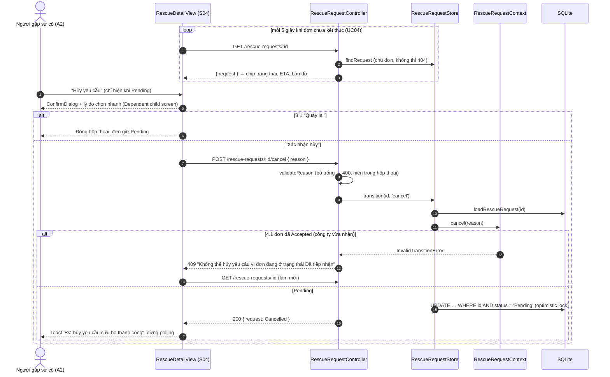
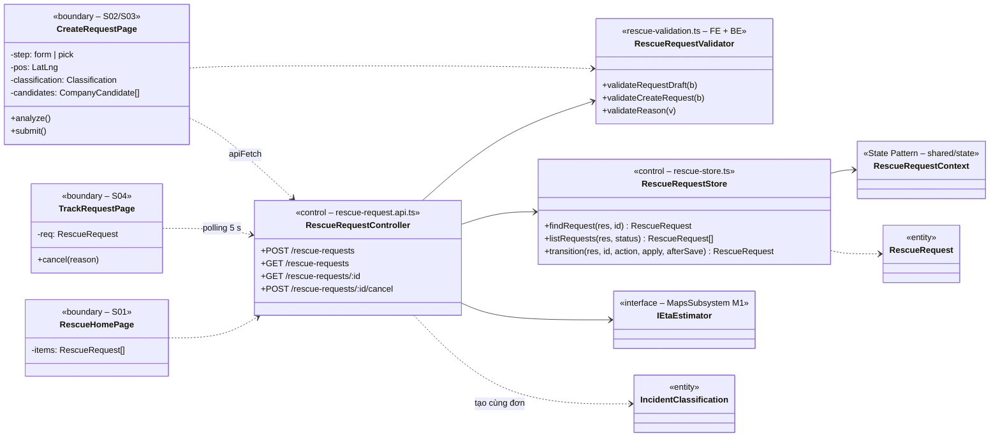

# M2 – Tuần 2: Luồng phía Người gặp sự cố (Yêu cầu & Hủy cứu hộ)

Hệ thống hỗ trợ sự cố xe trên đường · Người phụ trách: M2 · Use Case: **UC03 Yêu cầu cứu hộ khẩn cấp**, **UC04 Theo dõi yêu cầu**, **UC05 Hủy yêu cầu cứu hộ**.
Hợp đồng: [api-contract.md §2, §3.4](../contracts/api-contract.md) · Bảng `rescue_requests`, `incident_classifications` trong [schema.sql](../contracts/schema.sql).
Lớp phân tích (báo cáo 2.1.1, 2.1.2): `RescueRequestForm`, `RescueDetailView`, `AIServiceBoundary`, `MapsBoundary`, `RescueRequestController`, `MatchingController`.

Sơ đồ viết bằng Mermaid (dán vào <https://mermaid.live> để xuất PNG cho báo cáo).

---

## 1. Mã nguồn

| File | Lớp thiết kế | Nội dung |
|---|---|---|
| [`src/rescue-request/rescue-request.api.ts`](../../src/rescue-request/rescue-request.api.ts) | `RescueRequestController` | `POST /rescue-requests`, `GET /rescue-requests`, `GET /rescue-requests/:id`, `POST /rescue-requests/:id/cancel` |
| [`src/rescue-request/rescue-store.ts`](../../src/rescue-request/rescue-store.ts) | `RescueRequestStore` (dùng chung với M3) | Đọc `RescueRequest` đúng dạng contract, lọc theo người đăng nhập (404 nếu không thuộc quyền), `transition()` = load → State Pattern → save có optimistic lock |
| [`src/rescue-request/rescue-validation.ts`](../../src/rescue-request/rescue-validation.ts) | `RescueRequestValidator` (FE + BE) | `validateRequestDraft`, `validateCreateRequest`, `validateReason`, … |
| [`src/rescue-request/RescueHomePage.tsx`](../../src/rescue-request/RescueHomePage.tsx) | `HomeBoundary` | S01, route `/` |
| [`src/rescue-request/CreateRequestPage.tsx`](../../src/rescue-request/CreateRequestPage.tsx) | `RescueRequestForm` | S02 → S03, route `/requests/new` |
| [`src/rescue-request/TrackRequestPage.tsx`](../../src/rescue-request/TrackRequestPage.tsx) | `RescueDetailView` | S04, route `/requests/:id` (polling 5 giây, hủy đơn) |
| [`src/rescue-request/rescue.test.ts`](../../src/rescue-request/rescue.test.ts) | Test | Tạo đơn + validation, E2E với phía công ty, hủy / xung đột 409, phân quyền 404/403 |

Phụ thuộc: `getEtaEstimator()` và `GET /matching/companies` của M1 (đóng vai `MapsBoundary` + `MatchingController`), `POST /ai/classify` (`AIServiceBoundary`, Tuần 3), `RescueRequestContext` (State Pattern), UI Kit M4.

---

## 2. Biểu đồ trình tự

### 2.1 UC03 – Yêu cầu cứu hộ khẩn cấp (gồm 2.1, 3.1, 4.1, 5.1, 5.2, 7.1)

```mermaid
sequenceDiagram
  autonumber
  actor A2 as Người gặp sự cố (A2)
  participant F as RescueRequestForm (S02/S03)
  participant AI as AIServiceBoundary (POST /ai/classify)
  participant MC as MatchingController
  participant RC as RescueRequestController
  participant E as IEtaEstimator (MapsSubsystem)
  participant DB as SQLite

  A2->>F: "Gọi cứu hộ ngay" (S01 → S02)
  F->>F: LocationPicker tự lấy GPS (≤ 5 s)
  alt 2.1 GPS bị từ chối / tín hiệu yếu
    F-->>A2: Banner vàng, chạm bản đồ để chọn vị trí / nhập mốc địa chỉ
  end
  A2->>F: Chọn loại xe, nhập mô tả (+ ảnh) → "Phân tích & Tìm cứu hộ"
  F->>F: validateRequestDraft()
  alt 3.1 thiếu vị trí / mô tả < 10 ký tự / SĐT sai
    F-->>A2: Lỗi dưới đúng ô, giữ dữ liệu
  else hợp lệ
    F->>AI: { description } (timeout 5 s)
    alt AI trả kết quả
      AI-->>F: incidentType, urgency, suggestedServiceTypeCode
    else 4.1 lỗi / 503 / quá giờ
      AI-->>F: 503 AI_UNAVAILABLE
      F-->>A2: Banner xanh "tự chọn loại dịch vụ"
    end
    F->>F: chuyển S03 (Dependent screen, giữ dữ liệu S02)
  end
  A2->>F: Chọn / đổi loại dịch vụ, cách sắp xếp (5.1)
  F->>MC: GET /matching/companies?…
  MC-->>F: { items: CompanyCandidate[] }
  alt 5.2 danh sách rỗng
    F-->>A2: "Không có đơn vị trong X km" + nút "Mở rộng lên X+10 km"
  end
  A2->>F: Chọn 1 công ty → "Gửi yêu cầu cứu hộ"
  F->>RC: POST /rescue-requests { companyId, serviceId, …, classification }
  RC->>RC: validateCreateRequest(body)
  RC->>DB: loại xe hợp lệ? gói thuộc công ty, isActive, công ty Approved?
  alt không hợp lệ
    RC-->>F: 400 VALIDATION_ERROR (field)
  else hợp lệ
    RC->>E: estimate(trạm, điểm sự cố) – server tự tính distanceKm
    RC->>DB: BEGIN; INSERT rescue_requests (Pending, estimated_price = giá gói); INSERT incident_classifications; COMMIT
    RC-->>F: 201 { request }
    F-->>A2: Chuyển S04 /requests/:id, banner "Đã gửi yêu cầu"
  end
  opt 7.1 mất mạng / lỗi máy chủ
    F-->>A2: Banner đỏ trên S03, giữ nguyên lựa chọn, bấm gửi lại
  end
```

### 2.2 UC04 + UC05 – Theo dõi và hủy yêu cầu (gồm 3.1, 4.1)



---

## 3. Thiết kế lớp (Design Class)



Quyết định thiết kế:
- S02 và S03 là **một component hai bước** → "Quay lại" và lỗi gửi đơn không làm mất dữ liệu (UC03-7.1); URL vẫn là `/requests/new`.
- Server **không tin số client gửi**: tự tính lại `distanceKm` (MapsSubsystem) và `estimatedPrice` (giá niêm yết của gói), kiểm tra gói còn `isActive` và công ty còn `Approved` tại thời điểm gửi.
- Khi AI không chạy (Tuần 2 luôn 503), phân loại lưu `source = MANUAL`, `incidentType` suy ra ngược từ loại dịch vụ người dùng chọn (bảng §4), `urgency = MEDIUM`.
- `photoUrl` chỉ nhận đường dẫn do `POST /uploads` trả về (`/api/uploads/<tên>.jpg|png|webp`) để công ty không bị dẫn tới trang ngoài.
- Hủy đơn đi qua `transition()` dùng chung → luật "chỉ hủy khi Pending" nằm ở State Pattern, không viết `if` trong controller.

---

## 4. Đặc tả màn hình (UI Spec)

| Màn hình | Control & dữ liệu | Sự kiện → xử lý |
|---|---|---|
| **S01** Home `/` | Nút Danger 56 px "Gọi cứu hộ ngay"; nhóm "Đang xử lý" (viền primary, ETA); "Lịch sử yêu cầu" (chip trạng thái, công ty, thời gian) | Nút → S02; chạm thẻ → S04 |
| **S02** Tạo yêu cầu `/requests/new` | `LocationPicker` (tự lấy GPS, banner vàng khi lỗi); ô Địa chỉ/mốc (≤ 255); 3 nút chọn loại xe; Mô tả (đếm `x/500`, tối thiểu 10); SĐT liên hệ (mặc định SĐT tài khoản); Ảnh hiện trường (JPG/PNG/WebP ≤ 5 MB, xem trước, "Bỏ ảnh") | "Phân tích & Tìm cứu hộ" → validate, lỗi dưới ô và focus ô lỗi → gọi AI (loading "Đang phân tích…") → S03 |
| **S03** Chọn đơn vị | Thẻ tóm tắt (kết quả AI hoặc banner "tự chọn dịch vụ", mô tả); chọn Loại dịch vụ; 3 nút sắp xếp Gần nhất / Đánh giá cao nhất / Cân bằng; danh sách thẻ radio (tên, gói, km, ETA, giá, ★); thanh dưới cố định "Gửi yêu cầu cứu hộ" | Đổi dịch vụ / sắp xếp / bán kính → tải lại; rỗng → "Mở rộng lên X km"; gửi → S04 (replace, không quay lại form đã gửi) |
| **S04** Theo dõi `/requests/:id` | Chip trạng thái; panel theo trạng thái (chờ xác nhận / ETA lớn "~N phút" + giờ cập nhật / hoàn tất / lý do hủy, từ chối); `MarkersMap` (sự cố đỏ, trạm xanh); thẻ công ty + nút "Gọi"; thông tin sự cố, mốc thời gian, ảnh | Polling 5 s tới khi kết thúc; "Hủy yêu cầu" (chỉ Pending) → `ConfirmDialog` lý do nhanh; Rejected → "Tìm đơn vị cứu hộ khác" → S02 |

## 5. Việc còn mở
1. Lưu bản nháp S02 khi mất mạng (UI Guidelines 3.2.1-c) – hiện chỉ giữ trong bộ nhớ trang; tải lại trang sẽ mất.
2. Nút nhắn tin / đánh giá trên S04 thuộc Tuần 3 (UC06, UC07).
