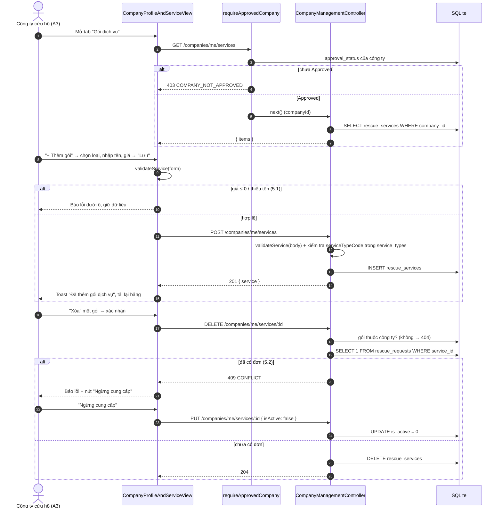
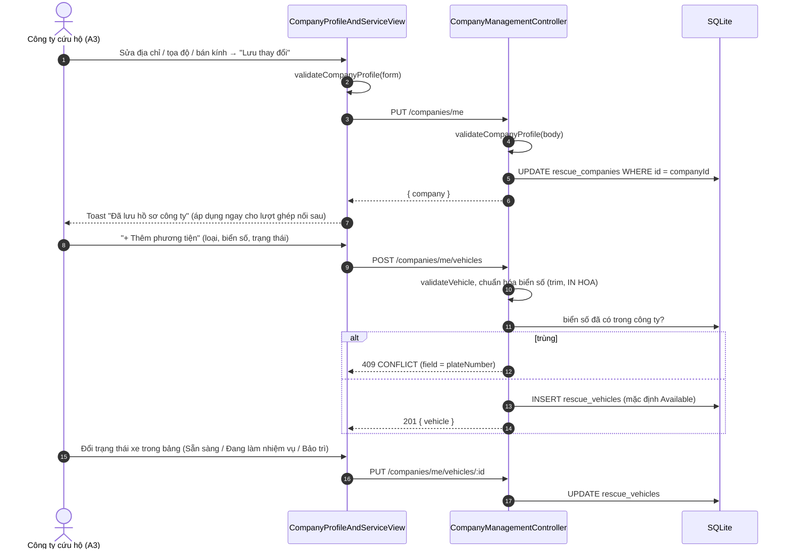
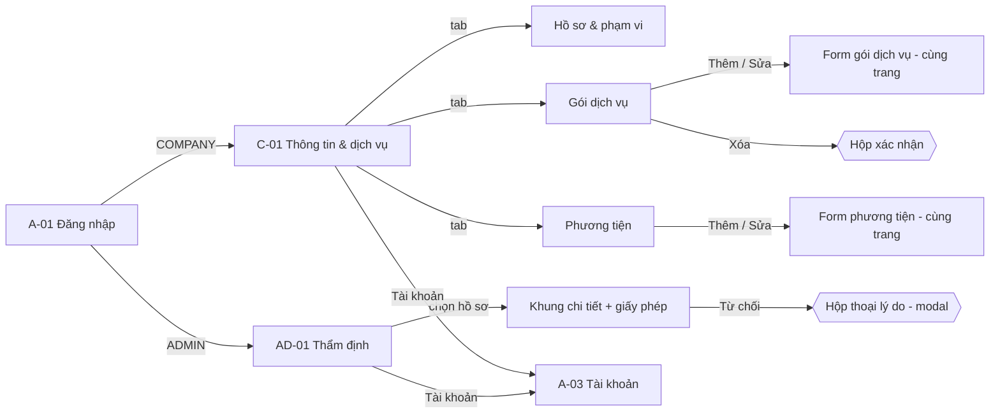
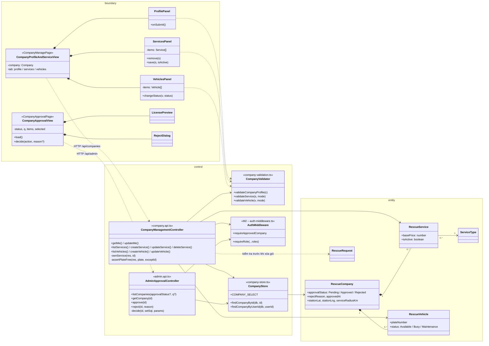

# M3 – Tuần 1: Quản lý năng lực cứu hộ & Thẩm định đối tác

Hệ thống hỗ trợ sự cố xe trên đường · Người phụ trách: M3 · Use Case: **UC08 Quản lý thông tin & dịch vụ cứu hộ**, **UC10 Thẩm định đơn vị cứu hộ**.
Hợp đồng: [api-contract.md §3.5, §3.6](../contracts/api-contract.md) · Bảng `rescue_companies`, `rescue_services`, `rescue_vehicles` trong [schema.sql](../contracts/schema.sql).
Lớp phân tích (báo cáo 2.1.3): `CompanyProfileAndServiceView`, `CompanyManagementController`, `CompanyApprovalView`, `AdminApprovalController`.

Sơ đồ viết bằng Mermaid (dán vào <https://mermaid.live> để xuất PNG cho báo cáo).

---

## 1. Mã nguồn

| File | Lớp thiết kế | Nội dung |
|---|---|---|
| [`src/company-management/company.api.ts`](../../src/company-management/company.api.ts) | `CompanyManagementController` | `GET/PUT /companies/me`, CRUD `/companies/me/services`, `/companies/me/vehicles` |
| [`src/company-management/admin.api.ts`](../../src/company-management/admin.api.ts) | `AdminApprovalController` | `GET /admin/companies` (lọc, tìm), `GET /admin/companies/:id`, `POST …/approve`, `POST …/reject` |
| [`src/company-management/company-store.ts`](../../src/company-management/company-store.ts) | `CompanyStore` | Đọc `Company` đúng dạng contract (dùng chung với `/auth/me`) |
| [`src/company-management/company-validation.ts`](../../src/company-management/company-validation.ts) | `CompanyValidator` | `validateService`, `validateVehicle`; hồ sơ dùng `validateCompanyProfile` (chung với đăng ký UC01, trong `auth-validation.ts`) |
| [`src/company-management/CompanyManagePage.tsx`](../../src/company-management/CompanyManagePage.tsx) | `CompanyProfileAndServiceView` | Màn hình C-01, route `/company` |
| [`src/company-management/CompanyApprovalPage.tsx`](../../src/company-management/CompanyApprovalPage.tsx) | `CompanyApprovalView` | Màn hình AD-01, route `/admin` |
| [`src/company-management/ApprovalChip.tsx`](../../src/company-management/ApprovalChip.tsx) | – | Chip trạng thái thẩm định |
| [`src/company-management/company.test.ts`](../../src/company-management/company.test.ts) | Test | Phân quyền, UC08-3a/3b/3c/5.1/5.2, UC10 lọc/duyệt/từ chối/409 |
| [`src/shared/ui/form.tsx`](../../src/shared/ui/form.tsx) | (tạm, M4 thay) | `Field`, `SelectField`, `InfoRow`, `useForm`, `useToast`, class nút |

Phân quyền dùng middleware của M2: `...requireRole('COMPANY')` cho `GET /companies/me` (công ty chưa duyệt vẫn xem được hồ sơ), `...requireApprovedCompany` cho mọi API UC08 khác, `...requireRole('ADMIN')` cho toàn bộ `/admin`.

---

## 2. Biểu đồ trình tự

### 2.1 UC08 – Thêm / xóa gói dịch vụ (luồng 3a, ngoại lệ 5.1, 5.2)



### 2.2 UC08 – Cập nhật hồ sơ / phạm vi (3c) và phương tiện (3b)



### 2.3 UC10 – Thẩm định đơn vị cứu hộ

```mermaid
sequenceDiagram
  autonumber
  actor A4 as Quản trị viên (A4)
  participant V as CompanyApprovalView
  participant C as AdminApprovalController
  participant DB as SQLite

  A4->>V: Mở "Thẩm định đơn vị cứu hộ"
  V->>C: GET /admin/companies?approvalStatus=Pending
  C->>DB: SELECT … WHERE approval_status = 'Pending'
  C-->>V: { items }
  opt 2a. Lọc / tìm kiếm
    A4->>V: Chọn trạng thái / nhập tên, số giấy phép, mã hồ sơ
    V->>C: GET /admin/companies?approvalStatus&q
  end
  A4->>V: Chọn một hồ sơ
  V->>V: Hiện chi tiết; HEAD licenseFileUrl
  alt 4.1 giấy phép không tải được
    V-->>A4: "Không tải được giấy phép" + nút "Tải lại" (hồ sơ vẫn Chờ duyệt)
  end
  alt Duyệt
    A4->>V: "Duyệt hồ sơ"
    V->>C: POST /admin/companies/:id/approve
    C->>DB: UPDATE … SET Approved, approved_at WHERE id AND approval_status = 'Pending'
  else 5a. Từ chối
    A4->>V: "Từ chối" → hộp thoại nhập lý do
    alt 5.1 bỏ trống lý do
      V-->>A4: "Vui lòng nhập lý do từ chối." (không gọi API)
    else
      V->>C: POST /admin/companies/:id/reject { reason }
      C->>DB: UPDATE … SET Rejected, reject_reason WHERE id AND approval_status = 'Pending'
    end
  end
  alt 6.1 không còn Pending (Admin khác vừa xử lý)
    C-->>V: 409 CONFLICT
    V->>C: GET /admin/companies/:id (làm mới)
    V-->>A4: Báo "Hồ sơ đã được xử lý trước đó"
  else thành công
    C-->>V: { company }
    V-->>A4: Toast "Đã duyệt / Đã từ chối", tải lại danh sách
  end
```

---

## 3. Đặc tả giao diện (UI Spec)

Theo UI Guidelines (báo cáo 3.2.1-a): **A3** desktop 1440 / tablet 768, padding 24 px, dòng bảng 48 px, nút thao tác 36 px; **A4** desktop 1440, sidebar cố định 240 px, padding 32 px. Màu/chữ lấy từ `design-tokens.css`.

### Sơ đồ chuyển màn hình



### C-01 Quản lý thông tin & dịch vụ cứu hộ (`/company`)
| Vùng / Control | Mô tả | Kiểm tra / Sự kiện |
|---|---|---|
| Header | Tên công ty + chip trạng thái thẩm định, link "Tài khoản" | – |
| Banner trạng thái | Chờ duyệt (vàng) / Bị từ chối + lý do (đỏ) | Chưa duyệt: chỉ hiện hồ sơ ở chế độ chỉ đọc, ẩn 3 tab |
| Tab **Hồ sơ & phạm vi** | Tên, SĐT, địa chỉ trạm, vĩ độ, kinh độ, bán kính (km); số giấy phép (link), đánh giá trung bình | `validateCompanyProfile`: bắt buộc, SĐT `^0\d{9}$`, tọa độ trong VN, bán kính > 0 → "Lưu thay đổi" → toast |
| Tab **Gói dịch vụ** | Bảng: loại dịch vụ, tên + mô tả, giá (VND), trạng thái, Sửa / Xóa; nút "+ Thêm gói" | Form: loại (bắt buộc, khóa khi sửa), tên (bắt buộc), giá nguyên > 0, mô tả tùy chọn, trạng thái (khi sửa). Xóa → xác nhận; 409 → banner + nút "Ngừng cung cấp" |
| Tab **Phương tiện** | Bảng: loại xe/thiết bị, biển số, trạng thái (select đổi ngay), Sửa; nút "+ Thêm phương tiện" | Loại, biển số bắt buộc; biển số tự IN HOA; trùng → lỗi dưới ô biển số |

### AD-01 Thẩm định đơn vị cứu hộ (`/admin`)
| Vùng / Control | Mô tả | Kiểm tra / Sự kiện |
|---|---|---|
| Sidebar 240 px | "Thẩm định đơn vị cứu hộ" (đang chọn), "Tài khoản" | Tuần 3 thêm Thống kê, Kiểm duyệt |
| Lọc trạng thái | Tất cả / Chờ duyệt (mặc định) / Đã duyệt / Bị từ chối | Đổi → tải lại danh sách |
| Ô tìm kiếm + "Tìm" | Theo tên, số giấy phép hoặc mã hồ sơ | Enter hoặc bấm "Tìm" |
| Bảng hồ sơ | Mã, tên (bấm để xem), số giấy phép, ngày nộp, chip trạng thái | Dòng đang chọn tô nền xanh nhạt |
| Khung chi tiết | Thông tin công ty, tọa độ, bán kính, ngày nộp / ngày duyệt / lý do từ chối; xem giấy phép (ảnh hoặc PDF) + "Mở trong tab mới" | Tải giấy phép lỗi → báo + "Tải lại" |
| Nút "Duyệt hồ sơ" / "Từ chối" | Chỉ hiện khi Chờ duyệt | Từ chối → modal bắt buộc lý do (1–255 ký tự); 409 → báo lỗi và làm mới hồ sơ |

---

## 4. Biểu đồ lớp thiết kế (Design Class)



**Quyết định thiết kế**
- **Sở hữu dữ liệu**: mọi truy vấn UC08 đều thêm `company_id = res.locals.companyId` (lấy từ token, không lấy từ client). Gói/xe của công ty khác → `404` (không lộ sự tồn tại – contract §1.2).
- **Không xóa cứng gói đã có đơn** (UC08-5.2): kiểm tra `rescue_requests.service_id` trước khi `DELETE`; đơn cũ vẫn tham chiếu được gói. Giao diện gợi ý ngay nút "Ngừng cung cấp" (`isActive = false`), gói ngừng cung cấp không vào danh sách ghép nối của M1.
- **Duyệt/từ chối dạng khóa lạc quan**: `UPDATE … WHERE approval_status = 'Pending'`; `changes = 0` → 404 hoặc 409. Hai Admin bấm cùng lúc thì chỉ một người thành công (UC10-6.1), cùng ý tưởng với `saveRescueRequest` của M1.
- **Một bộ validation cho FE và BE**; hồ sơ công ty dùng chung `validateCompanyProfile` với form đăng ký UC01 nên quy tắc tọa độ/bán kính không lệch nhau.
- **Biển số chuẩn hóa** (trim + IN HOA) trước khi kiểm tra trùng → `29c-123.45` và `29C-123.45` là một xe.

---

## 5. Ghi chú cho thành viên khác
- **M1 (matching)**: ứng viên ghép nối chỉ lấy `approval_status = 'Approved'` và `rescue_services.is_active = 1`; bán kính trong `rescue_companies.service_radius_km`.
- **M2/M3 Tuần 2**: trang điều phối đơn của công ty (UC09) đặt thêm tab hoặc route `/company/requests`; dùng `...requireApprovedCompany` và `res.locals.companyId`.
- **M4**: `src/shared/ui/form.tsx` là bản tạm (Field, SelectField, InfoRow, useForm, useToast, class nút). Thay bằng UI Kit nhưng giữ tên export; thay ô nhập tọa độ bằng component bản đồ; thay `confirm()` khi xóa gói bằng Modal.

## 6. Việc còn mở (họp Chủ Nhật)
1. Contract chưa có **xóa phương tiện** (`DELETE /companies/me/vehicles/:id`) và **công ty bị từ chối nộp lại hồ sơ** – cần M1 bổ sung nếu nhóm muốn.
2. Danh sách Admin chưa phân trang (đúng contract MVP).
