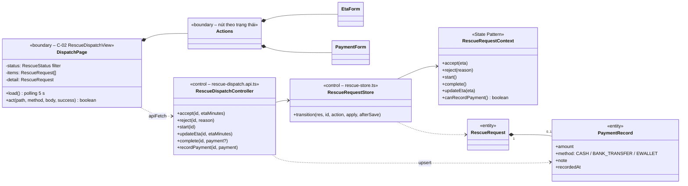

# M3 – Tuần 2: Luồng phía Công ty cứu hộ (Tiếp nhận & điều phối)

Hệ thống hỗ trợ sự cố xe trên đường · Người phụ trách: M3 · Use Case: **UC09 Tiếp nhận và điều phối cứu hộ**.
Hợp đồng: [api-contract.md §2, §3.4](../contracts/api-contract.md) · Bảng `rescue_requests`, `payment_records` trong [schema.sql](../contracts/schema.sql).
Lớp phân tích (báo cáo 2.1.3.2): `RescueDispatchView`, `RescueDispatchController`, `RescueRequest`, `PaymentRecord`.

Sơ đồ viết bằng Mermaid (dán vào <https://mermaid.live> để xuất PNG cho báo cáo).

---

## 1. Mã nguồn

| File | Lớp thiết kế | Nội dung |
|---|---|---|
| [`src/rescue-request/rescue-dispatch.api.ts`](../../src/rescue-request/rescue-dispatch.api.ts) | `RescueDispatchController` | `POST …/:id/accept`, `…/reject`, `…/start`, `PATCH …/:id/eta`, `POST …/:id/complete`, `PUT …/:id/payment` |
| [`src/rescue-request/rescue-store.ts`](../../src/rescue-request/rescue-store.ts) | `RescueRequestStore` (chung với M2) | `findRequest`, `listRequests` (COMPANY chỉ thấy đơn giao cho mình), `transition()` |
| [`src/rescue-request/rescue-validation.ts`](../../src/rescue-request/rescue-validation.ts) | `RescueRequestValidator` | `validateEta` (1–600), `validateReason`, `validatePayment` |
| [`src/rescue-request/DispatchPage.tsx`](../../src/rescue-request/DispatchPage.tsx) | `RescueDispatchView` | Màn hình C-02, route `/company/dispatch` |
| [`src/rescue-request/rescue.test.ts`](../../src/rescue-request/rescue.test.ts) | Test | E2E nhận → bắt đầu → ETA → hoàn tất + thanh toán, từ chối, 409 khi đơn đã hủy, phân quyền |

Danh sách/chi tiết đơn dùng chung `GET /rescue-requests` và `GET /rescue-requests/:id` (trong `rescue-request.api.ts`) với middleware `requireRequestViewer` = USER hoặc COMPANY **đã duyệt**. Mọi thao tác công ty dùng `requireApprovedCompany` (M2).

---

## 2. Biểu đồ trình tự – UC09 (gồm 3a, 4.1, 4.2, 5a, 5.1, 6a, 7.1)

```mermaid
sequenceDiagram
  autonumber
  actor A3 as Công ty cứu hộ (A3)
  participant V as RescueDispatchView (C-02)
  participant DC as RescueDispatchController
  participant S as RescueRequestStore
  participant CTX as RescueRequestContext
  participant DB as SQLite

  loop mỗi 5 giây
    V->>DC: GET /rescue-requests?status (+ GET /:id nếu đang mở)
    DC-->>V: { items } – đơn Pending mới → toast "Có N yêu cầu cứu hộ mới"
  end
  A3->>V: Chọn đơn Pending → xem chi tiết (vị trí, loại xe, mô tả, ảnh, dịch vụ, SĐT khách)
  A3->>V: Nhập ETA → "Nhận đơn"
  V->>V: validateEta (4.2: trống / ≤ 0 → lỗi dưới ô ETA)
  V->>DC: POST /:id/accept { etaMinutes }
  DC->>S: transition(id, 'accept')
  S->>CTX: accept(eta)
  alt 4.1 khách vừa hủy (Cancelled)
    CTX-->>DC: InvalidTransitionError
    DC-->>V: 409 "Không thể nhận đơn vì đơn đang ở trạng thái Đã hủy"
    V->>DC: tải lại chi tiết
  else Pending
    S->>DB: UPDATE … WHERE status = 'Pending'
    DC-->>V: { request: Accepted, etaMinutes }
  end
  opt 3a. Từ chối
    A3->>V: "Từ chối đơn" → ConfirmDialog (lý do nhanh / tự nhập)
    V->>DC: POST /:id/reject { reason } → Rejected
  end
  A3->>V: "Bắt đầu xử lý"
  V->>DC: POST /:id/start → InProgress
  opt 5a. Cập nhật ETA (Accepted / InProgress)
    V->>DC: PATCH /:id/eta { etaMinutes }
  end
  A3->>V: "Hoàn tất cứu hộ" → hộp thoại thanh toán (số tiền mặc định = giá niêm yết)
  alt Hoàn tất & lưu thanh toán
    V->>DC: POST /:id/complete { payment }
    DC->>DC: validatePayment (7.1: lỗi → dưới ô, giữ dữ liệu)
    DC->>S: transition(id, 'complete', afterSave = ghi payment_records)
    S->>DB: BEGIN; UPDATE status = Completed; INSERT payment_records; COMMIT
  else 6a. Ghi thanh toán sau
    V->>DC: POST /:id/complete {}
    A3->>V: (sau đó) form "Ghi nhận thanh toán"
    V->>DC: PUT /:id/payment { amount, method, note }
    DC->>CTX: canRecordPayment()? (khác Completed → 409)
    DC->>DB: INSERT … ON CONFLICT DO UPDATE payment_records
  end
  Note over V,DC: 5.1 – thao tác sai vòng đời (vd. Pending → complete, sửa ETA khi Completed) đều bị State Pattern chặn → 409 + banner
```

---

## 3. Thiết kế lớp (Design Class)



Quyết định thiết kế:
- Bảng thao tác hiển thị đúng theo trạng thái (Pending: ETA + Nhận / Từ chối; Accepted: Bắt đầu + sửa ETA; InProgress: sửa ETA + Hoàn tất; Completed: form thanh toán). Server vẫn kiểm tra lại bằng State Pattern nên giao diện cũ (chưa kịp polling) cũng không làm sai vòng đời.
- Hoàn tất + thanh toán ghi **trong cùng transaction** (`afterSave` của `transition`): không có đơn Completed với nửa bản ghi thanh toán.
- Thanh toán là **quyền** của trạng thái Completed (`canRecordPayment`), không phải trạng thái mới; ghi lại được nhiều lần (sửa sai số tiền).
- Đơn của công ty khác → 404 (không lộ sự tồn tại); công ty chưa duyệt → 403 `COMPANY_NOT_APPROVED`.

---

## 4. Đặc tả màn hình C-02 – Điều phối đơn cứu hộ (`/company/dispatch`, desktop 1440)

| Vùng | Control & dữ liệu | Sự kiện → xử lý |
|---|---|---|
| Thanh trên | "Điều phối đơn" (đang chọn), "Hồ sơ & dịch vụ" → C-01, "Tài khoản" | Điều hướng (C-01 có link ngược "Điều phối đơn cứu hộ" khi đã duyệt) |
| Bộ lọc | `SelectField` Trạng thái (Tất cả + 6 trạng thái); banner vàng "N yêu cầu đang chờ tiếp nhận" | Đổi lọc → tải lại ngay |
| Bảng đơn | Mã, Gửi lúc, Dịch vụ, Phương tiện, Khoảng cách, chip trạng thái; dòng đang chọn tô xanh | Polling 5 s; đơn Pending mới → toast; chạm mã → mở chi tiết |
| Chi tiết | Khách, SĐT (bấm gọi), loại xe, dịch vụ + giá, phân loại sự cố (AI / khách tự chọn), khoảng cách, địa chỉ, tọa độ, mô tả, ảnh (mở tab mới), ETA, lý do hủy/từ chối, thanh toán; `MarkersMap` sự cố + trạm | Tự làm mới cùng polling |
| Thao tác | Theo trạng thái (mục 3); ETA số nguyên 1–600; form thanh toán: Số tiền (≥ 0), Phương thức, Ghi chú (≤ 255) | Lỗi theo ô hiện dưới ô; 409 / lỗi mạng → banner đỏ + nút "Tải lại"; thành công → toast |
| Hộp thoại | Từ chối: `ConfirmDialog` lý do nhanh; Hoàn tất: `Modal` thanh toán với "Hoàn tất & lưu thanh toán" / "Ghi thanh toán sau" | Esc / Quay lại để đóng |

## 5. Việc còn mở
1. Gán phương tiện (`rescue_vehicles`) cho đơn khi nhận chưa có trong contract – đề xuất bàn ở họp Chủ Nhật nếu cần cho demo.
2. Thông báo đơn mới hiện chỉ là toast khi đang mở trang C-02 (polling); không có âm thanh / push.
