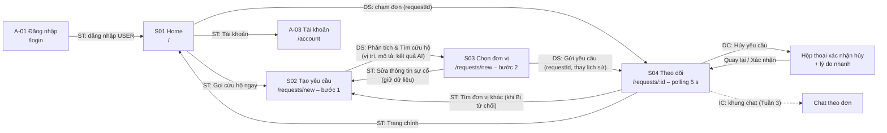
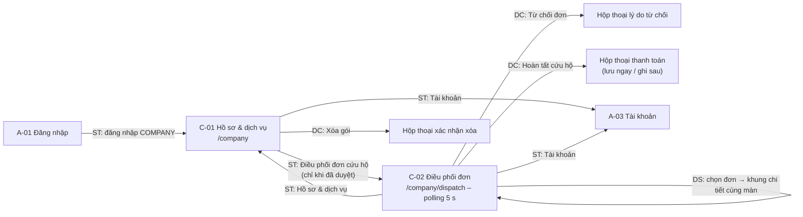
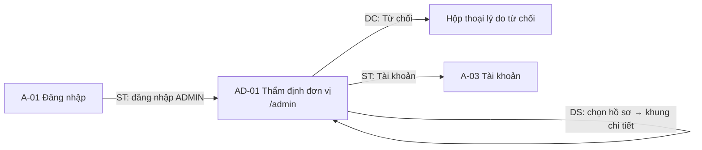

# M4 – Tuần 2: Ghép nối luồng & Kiểm soát chất lượng UI

Hệ thống hỗ trợ sự cố xe trên đường · Người phụ trách: M4 · Dùng cho báo cáo mục **3.2.2** (Sơ đồ chuyển màn hình) và **3.2.3** (Đặc tả màn hình).
Căn cứ: [UI Guidelines M4](../../../M4/01_UI_Guidelines_M4.docx), [Screen Transition Diagram bản Giai đoạn 0](../../../M4/02_Screen_Transition_Diagram.pdf), [M4-tuan1-ui-kit.md](M4-tuan1-ui-kit.md).

Sơ đồ viết bằng Mermaid (dán vào <https://mermaid.live> để xuất PNG cho báo cáo). Ký hiệu cạnh theo 4 mẫu chuyển màn hình (slide Bài 05): **ST** Simple transition, **DS** Dependent screen (mang dữ liệu), **DC** Dependent child screen (modal chặn màn cha), **IC** Independent child screen.

---

## 1. Sơ đồ chuyển màn hình cập nhật theo giao diện thực tế

### 1.1 Phân hệ Người gặp sự cố (A2) – mobile 390 × 844

### 1.2 Phân hệ Công ty cứu hộ (A3) – desktop 1440

### 1.3 Phân hệ Quản trị viên (A4) – desktop 1440 (không đổi so với Tuần 1)

Thay đổi so với bản Giai đoạn 0: S02 và S03 dùng chung một route hai bước (giữ dữ liệu khi quay lại); S03 thêm lựa chọn sắp xếp "Cân bằng"; S04 thêm lối "Tìm đơn vị khác" khi bị từ chối; phân hệ Công ty có thêm C-02 nối hai chiều với C-01.

---

## 2. Bảng đặc tả màn hình (theo giao diện đã chạy)

Chi tiết control của S01–S04 ở [M2-tuan2 §4](M2-tuan2-yeu-cau-cuu-ho.md#4-đặc-tả-màn-hình-ui-spec), C-02 ở [M3-tuan2 §4](M3-tuan2-dieu-phoi.md#4-đặc-tả-màn-hình-c-02--điều-phối-đơn-cứu-hộ-companydispatch-desktop-1440). Bảng dưới tóm tắt mức chuẩn hóa cấu hình (UI Guidelines 3.2.1) đã kiểm tra trên từng màn:

| Màn hình | Bố cục | Nút chính | Trạng thái chờ | Thông báo |
|---|---|---|---|---|
| S01 | 1 cột, `max-w-md`, lề 16 px | Danger 56 px "Gọi cứu hộ ngay" | "Đang tải…" | Banner đỏ khi lỗi tải |
| S02 | 1 cột, bản đồ 240 px | Primary 48 px full-width | Nút "Đang phân tích…", ô ảnh "Đang tải ảnh lên…" | Lỗi dưới ô + focus ô lỗi; banner vàng GPS |
| S03 | 1 cột, thanh gửi cố định đáy | Primary 48 px "Gửi yêu cầu cứu hộ" (disabled tới khi chọn) | "Đang tìm…", nút "Đang gửi yêu cầu…" | Banner xanh AI fallback; vàng + nút mở rộng bán kính; đỏ khi gửi lỗi |
| S04 | 1 cột | Danger 48 px "Hủy yêu cầu" (chỉ Pending) | Polling ngầm, banner vàng nếu lỗi cập nhật | Banner theo trạng thái; toast hủy thành công |
| C-02 | Bảng + khung chi tiết 480 px (xếp dọc dưới 1280 px) | Action 36–48 px | Nút loading khi gửi | Toast thành công / đơn mới; banner đỏ + "Tải lại" |

---

## 3. Xử lý lỗi & kiểm tra đầu vào theo chuẩn đã cam kết

Một bộ quy tắc validation dùng cho **cả form và API** ([`rescue-validation.ts`](../../src/rescue-request/rescue-validation.ts), [`auth-validation.ts`](../../src/auth/auth-validation.ts)); API trả `details.field` để UI báo đúng ô.

| Tình huống (báo cáo 3.2.1-c / đặc tả UC) | Hành vi UI | Nơi cài |
|---|---|---|
| Không tải được danh mục phương tiện / dịch vụ | Banner đỏ + "Thử lại"; khóa nút phân tích tới khi danh mục sẵn sàng | S02 `loadCatalogs` |
| Thiếu vị trí, mô tả < 10 / > 500 ký tự, SĐT sai (UC03-3.1) | Chữ đỏ dưới ô, viền đỏ, focus ô lỗi đầu tiên, giữ dữ liệu | S02 `validateRequestDraft` |
| GPS bị từ chối / quá 5 s (UC03-2.1) | Banner vàng, chạm bản đồ để chọn | `LocationPicker` |
| AI lỗi / 503 / quá 5 s (UC03-4.1) | Banner xanh, người dùng tự chọn loại dịch vụ | S03 |
| Không có công ty trong bán kính (UC03-5.2) | Banner vàng + nút "Mở rộng lên X km" | S03 |
| Mất mạng / lỗi máy chủ khi gửi (UC03-7.1, UC09-7.1) | Banner đỏ, form/modal và dữ liệu giữ nguyên để gửi lại; `NetworkBanner` báo mất mạng | S03, C-02, `apiFetch` |
| Trạng thái đơn đã bị bên kia đổi (UC05-4.1, UC09-4.1, 5.1) | Đóng hộp thoại, banner đỏ nêu trạng thái hiện tại ("Không thể hủy yêu cầu vì đơn đang ở trạng thái Đã tiếp nhận"), tự tải lại đơn | `InvalidTransitionError` (message tiếng Việt) + S04/C-02 |
| Lý do hủy / từ chối bỏ trống | Lỗi trong hộp thoại, không gọi API | `ConfirmDialog` |
| ETA trống / ≤ 0 / > 600 (UC09-4.2) | Lỗi dưới ô ETA | `EtaForm` + `validateEta` |
| Số tiền âm, chưa chọn phương thức (UC09-7.1) | Lỗi dưới ô, giữ dữ liệu | `PaymentForm` + `validatePayment` |
| Bấm gửi 2 lần | Nút loading khóa thao tác | `Button loading` |

---

## 4. Bổ sung vào UI Kit dùng chung (`src/shared/ui/`)

| File | Thêm mới | Dùng ở |
|---|---|---|
| [`use-polling.ts`](../../src/shared/ui/use-polling.ts) | `usePolling(load, ms, deps)` – gọi ngay rồi lặp; bỏ lượt khi tab ẩn hoặc lượt trước chưa xong; `ms = null` để dừng | S04 (dừng khi đơn kết thúc), C-02 |
| [`format.ts`](../../src/shared/ui/format.ts) | `formatVnd`, `formatDateTime`, `formatTime` | S01, S03, S04, C-02 |
| [`modal.tsx`](../../src/shared/ui/modal.tsx) | `ConfirmDialog` prop `reasonOptions` – chip lý do chọn nhanh, chạm để điền, vẫn sửa được | Hủy yêu cầu (UC05 bước 2), từ chối đơn (UC09-3a); demo ở `/ui-kit` |
| [`feedback.tsx`](../../src/shared/ui/feedback.tsx) | `RESCUE_STATUS_UI` lấy nhãn từ `RESCUE_STATUS_LABEL` (State Pattern) – một nguồn nhãn cho chip và thông báo lỗi 409 | Mọi màn có chip trạng thái |

---

## 5. Kết quả kiểm tra ghép nối

### 5.1 Kiểm tra thủ công có sẵn (26/11/2026)

Chạy `npm run dev` với CSDL demo (1 người dùng, 2 công ty đã duyệt ở Hà Nội), OSRM công khai:

1. S01 → S02: GPS bị từ chối → banner vàng; bấm gửi khi trống → lỗi vị trí; chạm bản đồ, nhập mô tả → S03.
2. S03: AI 503 → banner tự chọn; chọn "Vá / thay lốp" → 2 công ty (1,2 km ~13 phút; 9,7 km ~31 phút); đổi sang "Kích bình" → banner mở rộng bán kính; gửi → S04 banner "Đã gửi".
3. Công ty nhận đơn (ETA 15) → S04 tự đổi sang "Đã tiếp nhận ~15 phút" sau ≤ 5 giây.
4. Mở hộp thoại hủy, công ty nhận đơn trước khi xác nhận → banner "Không thể hủy… Đã tiếp nhận", trang tự làm mới. Hủy đơn khác: bỏ trống lý do → báo lỗi; chọn lý do nhanh → toast thành công.
5. C-02: đơn mới → toast "Có 1 yêu cầu cứu hộ mới"; ETA trống → lỗi dưới ô; nhận (18 phút) → Bắt đầu xử lý → Hoàn tất & lưu thanh toán 80.000 đ tiền mặt.
6. Khách hủy ngay trước khi công ty bấm "Nhận đơn" → banner "Không thể nhận đơn… Đã hủy", bảng tự cập nhật.

### 5.2 Kiểm thử hồi quy UI do M4 bổ sung (27/11/2026)

File [`ui-flow.ui.test.tsx`](../../src/rescue-request/ui-flow.ui.test.tsx) kiểm tra phần ghép nối mà không thay thế test nghiệp vụ API của M2/M3:

1. S01 tải lỗi → hiện nút "Thử lại" → tải thành công và xóa banner cũ.
2. S04 tải lỗi → thử lại đúng `requestId` đang mở và hiển thị chi tiết đơn.
3. S02 tải danh mục lỗi → khóa nút tiếp tục → thử lại, phục hồi danh mục phương tiện/dịch vụ.
4. C-02 từ chối đơn khi mất mạng → giữ modal và lý do đã nhập để gửi lại.
5. [`use-polling.test.tsx`](../../src/shared/ui/use-polling.test.tsx) xác nhận không tạo request chồng nhau khi mạng chậm hơn chu kỳ 5 giây.

Lệnh kiểm tra: `npm run test:all`, `npm run typecheck`, `npm run build`. Kết quả ngày 27/11/2026: 30 test API/nghiệp vụ và 14 test UI đều đạt; typecheck và production build đạt.

## 6. Việc còn mở
1. Cập nhật lại file PDF Screen Transition Diagram và Figma theo mục 1 (xuất PNG từ Mermaid để chèn báo cáo).
2. Chụp màn hình S01–S04, C-02 cho chương Thiết kế giao diện (Tuần 4).
3. Lưu bản nháp S02 khi mất mạng – chưa làm (xem M2-tuan2 §5).
